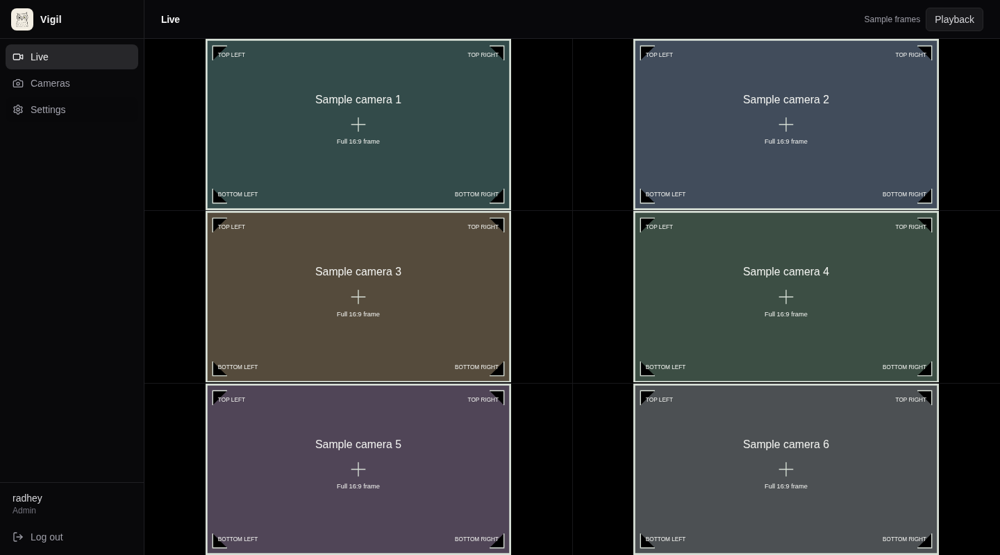
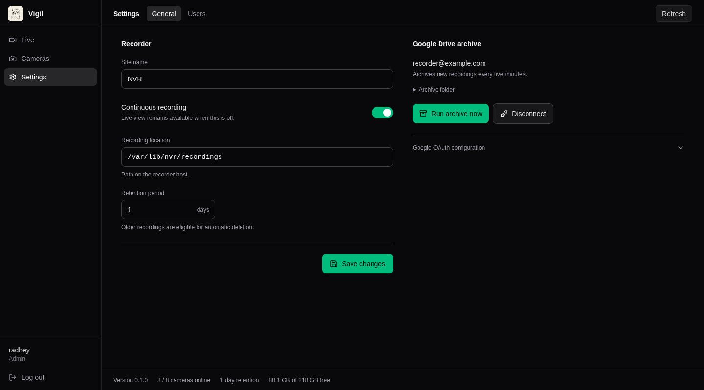

# Dashboard video and Settings previews

These screenshots render the dashboard components in an isolated browser fixture.
Settings uses sample data. Live uses six 16:9 test frames with a marker at each corner.
The screenshots do not show a connection to a recorder or real camera streams.

The browser fixture confirmed that all six video elements use `object-fit: contain`.
It also confirmed that the Settings footer sits outside the scrolling main area,
reaches the viewport bottom, disappears on Live, and returns on Settings.

The HLS query and media transport were mocked for this visual check. Real HLS and
WebRTC connections, recording playback, Settings mutations, and Drive actions were
not tested against a recorder.
